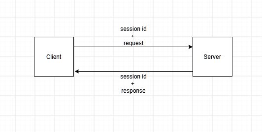
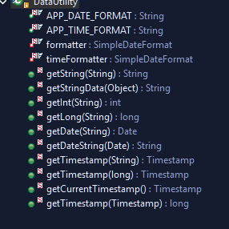
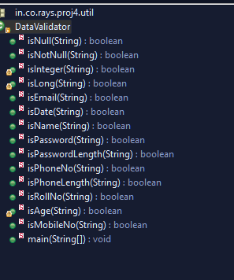

- [[Wed, 09-09-2026]]
	- # Denormalization
	  collapsed:: true
		- Example
			- `st_user` does not have `role_name` column; it has `role_id`
			- if we run `roleModel's` `findByPk(bean.roleId)` we get `rolebean`. from it we print `role_name`
			- the problem is based on the list we get ; if it has 4 records ; findbypk will run 4 times; response time is increasing
		- So to reduce join queries we use Denormalization
			- we denormalize `st_student` using `college_name`
				- in `st_student` we need `college_name` so we have recreated it here.
				- so we don't need to run `findByPk()` like we did in st_user again and again.
				- Examples:
					- college_id college_name in `student`
					- `student_id` `name` in `st_marksheet`
					- `faculty` having `college_id` `college_name` both N and D happening respectively.
					-
	- # Normalization
	  collapsed:: true
		- Why
			- table has duplicate entries that's why we created a main table and used its primary key as foreign key to remove duplicate entry.
		- it removes duplicate entries
		- In `st_student` we used `College_id` to normalize
		- Increment in `JOIN` queries
			- in st_user we have seen; it does not have rolename, so for that we need to pass role_id in rolemodel's findbypk to get rolename
		-
	- # Primary key
		- It uniquely identifies each row in a table
		- Can't be duplicated.
		- Only one can be made in a table.
		- Types
			- ## Business
				- Contains business/user information; Not related with database.
				- related to user record.
				- it is generally large in size.
					- ex. `email_id`, `voter_id`, `phone_no`,`roll_no`
					- can be used but we don't make it PK.
						- because
							- not a standard
							- need to be entered manually
							- not autogenerated.
							- not auto increment.
							- we use it in many places
							- in future, can have some changes.
							- it has existence outside table/database.
							-
			- ## Non Business
				- Auto incremented integer columns
				- Does not contain business information ; related with database.
				- Not related to user record.
				- No existence outside database/table.
				- we use this.
		-
- [[10-09-2026]]
	- # ORS
		- Online Result System
		- It maintains student and marksheet records. #def
		- having 8 tables
			- user
			- student
			- marksheet
			- faculty
			- college
		- How have you made this project?
			- have used `maven project`
		- What is maven?
			- It is a powerful build automation tool #def
		- How `WAR` file gets created?
			- After building project war file gets created.
				- after building we store it in webapp of tomcat and run.
		- How to deploy project?
			- we first build the project
			- `WAR` file gets created
			- after building we store it in webapp of tomcat and run.
		- MVC Architecture
			- It is a framework methodology that separates code implementation in 3 components: #def
				- *Model*
					- communicates with database.
					- performs data access logic.
						- create, update delete add in model. crud operations.
					- performs business logic
						- when we create a new custom method using data access logic -> business method #def
						- code that checks whether the data present in database -> business logic #def
						- authenticate, register (add + email), reset password(update) forget password.
					- performs integration logic.
						- when we integrate third party application.
						- register method ( add + send email)
				- *View*
					- performs presentation logic. #def
				- *Controller*
					- Controls request #def
						- Link (GET)
							- request goes to controller from view.
							- calls model and get the data from database and give it to view.
						- Button (POST)
							- Submit Logic
							- Calls model and take the data to database.
						- Neither GET nor POST
							- request goes from controller to view.
					- Performs navigation logic.
						- The controller navigates to the appropriate action based on the incoming request.
	- # Design Patterns
		- These are industry's best coding practices
		- These are followed in order to provide standard solutions for standard problems while developing an application #def
		- ## Types
			- ## **Singleton**
				- `JDBCDataSource` follows Singleton design pattern
					- we made it singleton because it acts as DCP(pool of connections; to reuse connection without destroying and recreating)
				- returns single object no matter how many times you have called it.
				- A class which has only one instance in their ((6ac892da-4125-49c2-add8-eb4a3ded8b19)) is called singleton class. #def
				  collapsed:: true
					- lifetime
					  id:: 6ac892da-4125-49c2-add8-eb4a3ded8b19
						- When we run the project/server; its instance gets created;
					- As long as the server remains running, only one instance exists, and no new instances are created.
					- It gets memory only one time
					-
				- ### Need to follow 4 steps:
					- *make the class final*
						- this class can't be extended or no child class can be created. #def
					- *make default constructor private*
						- when we create an object we call constructor
						- now its object (final class) can't be created.
					- *declare self or class type static attribute.*
						- static because java will allocate the memory once.
					- *make static `getInstance()` returns same class object.*
						- can be called without creating objects.
							- call it using `className.getInstance()`
						-
			- ## **Factory**
				- The class which has ability to create object of another class. #def
					- using in every model
					- Ex
						- To make connection with database we use `JDBCDataSource.getConnection()` returns `Connection` object
							- `JDBCDataSource` class returning object of `Connection` class.
						- `Connection.prepareStatement()` returns `PreparedStatement` object.
						- `DriverManager.getConnection()`returns `Connection` object.
			- ## **Builder**
				- Make complex object using simple object.#def
					- Ex.
						- We have applied this design in `EmailBuilder` class
							- created complex object called `msg` using `StringBuilder msg = new StringBuilder();`
							- using simple objects like `msg.append("<HTML><BODY>");`
							- we have appended it in msg to create complex object.
			- ## **Front Controller**
				- Front controller is a filter and checks whether session has user information
					- `if(session.getAttribute("user")!=null) `
				- How you made front controller?
					- We have implemented it using filter and overridden life cycle methods.
				- 3 lifecycle methods
					- init
					- doFilter
						- gets called automatically for every user request.
					- destroy
				- The main controller which perform session checking and login operation before calling any application controller.#def
					- security guard on a gate of an institution is front controller checks whether the person should be given access or not.
					- It checks if the user is authorized to see contents of web app after log in.
				- Application checks that before request goes from view to controller ; checks the session in between view and controller whether the user is logged in or not using FC
					- application checks only for controllers which needs to be access after login
				- To apply use pattern /ctl/* url pattern.
					- prefix should be /ctl/
				- `chain.doFilter(req, resp);` request goes to next controller if user has logged in succesfully.
				- registration, login, forget password, welcome here we didn't apply ; we didn't use /ctl/
				-
				-
- [[Fri, 11-09-2026]]
	- # DCP
		- earlier we used to create connection in every method
		- DCP has pool of connections which can be reused.
		- ### why we have created `JDBCDataSource` class.
			- so that no need to create connection with database repeatedly. make the connection centralized for database connectivity.
			- it reuses the connections using dcp. ( without destroying the connection ; we can reuse it.)
				- if in a web app for ex. 10 users came and using your application; class needs to create connection 10 times.
					- initial pool size (10) means As soon as you start the server, DCP creates 10 database connections in advance. these will remain open no matter what.
					- acquired increment (10) : for 11th user ; using this property DCP creates 10 more connections. now total connections are 20; 9 are free. and so on. up to 100 ; for 101st user it won't create new connection ; he/she has to wait until existing connection gets free.
					- timeout : if certain connection hasn't used for certain amount of time , then it gets auto closed.
					- max pool size (100)
		- ### why we are creating single instance of `JDBCDataSource`
		  collapsed:: true
			- if we created 10 instances of this class then max pool size gets to 1000 if initially for a single instance it was 100.
- [[Tue, 15-09-2026]]
  collapsed:: true
	- # Session
		- 
			- conversation between browser and server.#def
			- User sends request for login ( login password ) if data exists in database then session object gets created and stored all info in session. server gets session id ; when response goes it sends session id too and save the response into browser as cookies.
			- with every request browser sends session id to server. Server verifies the session id. and stores in browser as cookie
			- Upon clearing history , cookies gets deleted. If browser made request then it does not have session id so server logs you out as it does not find any session id.
	- ## Two types of validations
		- Server Side
			- We have used this one
			- Validations check on servers.
			- Project deployed on servers.
				- request goes from browser to server; in response we get error or success messages.(Login is required ; password is required)
			- 2 types:
				- Programmative
					- Validations created by programmer.
					- 2 types:
						- Input Validations
							- Validate input data entered by users. #def
						- Business Validations
							- Checks business conditions that may need database communication. #def
							- duplicate records exception
							-
				- Declarative
					- using predefined annotations.
		- Client Side
			- Here JavaScript is used
				- can be enabled/disabled at browser end.
					- if someone has disabled JavaScript ; then validations won't work and wrong entries go into database hence unnecessary errors.
- [[Wed, 16-09-2026]]
  collapsed:: true
	- ## Email
		- ### To integrate/use/configure email
		  collapsed:: true
			- We added `jakarta-mail` dependancy in pom.xml  which has version 2.0.1
			- defined SMTP parameters in  `system.properties` in key value pair
			  collapsed:: true
				- ```
				  smtp.server=smtp.gmail.com (email host; server's host is ip address)
				  smtp.port=465 (server's port)
				  email.login=encode3983@gmail.com
				  email.pwd=ahda gtgb bxiy oxlx (generated token from app password in gmail)
				  ```
				- A host is the address used to locate a server on a network #gpt
			- we made 6 predefined and 3 custom classes
				- custom classes
					- **EmailMessage** → holds the email data (to, subject, message) #claude
					- **EmailUtility** → handles the work of sending the mail #claude
					- **EmailBuilder** → builds the mail content (the HTML message) #claude
				- predefined classes
					- transport
					- message
					- MIME message
						- Multipurpose Internet Mail Extensions
					- password authentication
					- internet address
					- session
			- We have used `EmailUtility.sendMail()` in that we used `transport class's send method` and sent the mail
			-
		- Email has 3 protocols
			- SMTP to send email.
			- IMAP
			- POP3
		- In our project emails do not get received.
		- To receive we need to use these 2 protocols
			- IMAP -> Internet Message Access Protocol
			- POP3 -> Post Office Protocol version 3
	- ## Exceptions
	  collapsed:: true
		- Abnormal condition during flow of execution.
		- 2 types of exception
			- checked
				- compile time
				- try-catch mandatory
			- unchecked
				- runtime
				- arithmetic exception
				- try-catch exceptional
		- Custom Exception
			-
		- ### Exception handling
			- If a program has exceptions and we don't handle it ; code of execution stops
			- As it is not possible to handle all exceptions with different names so we categorize those into 4 types
			  collapsed:: true
				- *Application*
					- any type of error.
				- *Database*
					- db related
				- *RecordNotFound*
					- if data not found in db.
				- *DuplicateRecordFound*
					- loginId already exist when doing signup with existing login id ; we use it in add(), update()
			- How to create custom exceptions
			  collapsed:: true
				- create a class
				- extend it with `runtimeException`
				- we create parameterized constructor
				- pass the argument in parameterized constructor in super().
				- the message goes to runtimeException.
					- ```java
					  
					  public class ApplicationException extends RuntimeException{
					  	public ApplicationException(String mesg) {
					  		super(mesg);
					  	}
					  }
					  ```
			- These custom exceptions are runtime exceptions. try-catch is not mandatory. unchecked.
			- #### Exception Propogation
			  collapsed:: true
				- Controller calls model to check if login id already exist ; we raise exception that it exists already then exception propagate from model to controller and controller display error on view
				-
- [[Thu, 17-09-2026]]
  collapsed:: true
	- # Utility Class
		- has reusable methods all are static methods so that they can be called directly by classname.
			- Data Validator has input validation methods
			- Data Utility has methods which converts data from one format to another.
			- Property reader which reads properties from system.properties.
			- JDBCDataSource is DCP , creates one instance
			- Html Utility has methods for dropdown
			- Message Source has internationalization method
		- We reuse the methods defined in these classes.
		- Email
			- Email Builder -> message builds here.
			- Email Utility
			- Email Message -> to, from , cc , subject attributes and its setter and getter methods.
		- Data
		  collapsed:: true
			- Data Utility
			  collapsed:: true
				- converts data from one format to another format #def
				- 
				- getString's input -> String ; returns String.
					- getString trims whitespaces.
				- getStringData converts object to string otherwise blank
				- getInt : if no. is int like for ex 12 then it converts string to int otherwise 0
				- getDate: `formatter.parse(val);` String to date (`private static final SimpleDateFormat formatter = new SimpleDateFormat(APP_DATE_FORMAT);`)
				- getDateString: date to string
				- getTimestamp : long to timestamp
			- Data Validator
			  collapsed:: true
				- validates input data entered by user #def
				- all methods are static here.
				- returns boolean
				- isNull
				  collapsed:: true
					- Input data is null then return true otherwise false
					- Likewise others.
					- 
						-
						-
				- isInteger
					- if val in String is no. type like 123 then `Integer.parseInt(val);` converts it to integer but if it is like 12a then `NumberFormatException` will be thrown
				- isEmail
					- `val.matches(emailreg)` matches pattern in emailreg which is of type regex.
		- JDBCDataSource
		- ServletUtility
		- Property Reader
		  collapsed:: true
			- to read data from .properties file
			- need to create resource bundle object to read properties
			- `getValue` method overloading concept going on
			- `getValue` returns key's value.
			- `getValue` with 2 args
				- if key value is `error.require={0} is required`
				- ```java
				  public static String getValue(String key, String param) { // param is login forex
				  		String msg = getValue(key);  //sets value  {0} is required in msg
				  		msg = msg.replace("{0}", param); //and replace {0} with param for ex. login
				  		return msg;
				  	}
				  ```
		- Html Utility
			- to avoid hardcoding we use dropdown's utility
			- for making dropdowns.
			- we have 2 types of dropdowns
				- ### static
				  collapsed:: true
					- every input is given by us.
					- data displayed here does not change generally
						- ex. gender, states
					- at runtime data does not add or change.
					- `public static String getList(String name, String selectedVal, HashMap<String, String> map)`
						- map has key value pair
							- `val = map.get(key);` get the key's value afind store in value.
							- on `UserView`
								- ```jsp
								  HashMap genderMap = new HashMap();
								  genderMap.put("M", "Male");
								  genderMap.put("F", "Female");
								  ```
								- `<%=HTMLUtility.getList("gender", bean.getGender(), genderMap)%>`
								- genderMap has `genderMap.put("M", "Male");`
								  `genderMap.put("F", "Female");`
								- `map.keySet();` it will get all the keys of map (all keys are unique) return type is Set.
								- used `for (String key : keys) ` for each loop; one by one keys go into key.
								- `val = map.get(key);` this returns value. map.get(M) gives Male
								- 2nd for loop gives Female.
								- `	sb.append("</select>");` select tag closed.
							- How `selectedVal` works
								- if we give `male` in selected value it will be pre-selected.
								- for ex in user registration we didn't give firstname lastname etc. just gave gender then validations run and errors come in empty fields as the new response came ; selected male get removed as new response generated
								- if we put male in selected value
									- ```java
									  if (key.trim().equals(selectedVal)) {
									    sb.append("<option selected value='" + key + "'>" + val + "</option>");
									  			}
									  ```
									- selected value is male; before value `selected` will be shown
									- if we give selectValue as male
										- `selected value='male'` will be shown and it gets preselected as male.
						- name is for gender parameter
						- selected value
							- after selecting male/female , pressing the button ; in response it gets selected what we sent before pressing the button
								- the following will run
									- ```java
									  boolean select = true;
									  		if (select) {
									  			sb.append("<option selected value=''>------------Select-------------</option>");
									  		}
									  ```
									- if condition will be true and that value gets selected.
								-
				- ### dynamic
					- data can be changed at runtime
						- if database has new entry then it will also be shown on dropdown
					- data shown on dropdown gets loaded from database.
					- the data we get from database is in form of list.
						- list has 8 types beans
							- the problem is for 8 types of beans we need to create 8 methods
							- 2nd problem is every bean has different fields.
								- so we made dropdownlistBean interface
									- made 2 methods having String return type
										- getkey
										- getValue
									- implemented in baseBean but did not override those methods. Hence baseBean becomes abstract
									- all the 8 child classes need to override these methods.
									- In each bean we have overridden these methods. In every bean we have returned `id+""` in getKey
									- in getValue whatever we need to return for ex name, login id, first name , last name.
									- this solved ==29:39==
		- Message Source
		  collapsed:: true
			- for internationalization
		- ServletUtility
		  collapsed:: true
			- Servlet related methods
	-
- [[Fri, 18-09-2026]]
  collapsed:: true
	- to get parameter like name from input field from view to controller we user `request.getParameter("name")`
	- dropdown has fixed options can't change it.
		- here we give parameter gender
- [[Mon, 21-09-2026]]
- [[Mon, 28-09-2026]]
  collapsed:: true
	- On clicking the link, how is this form came?
	  collapsed:: true
		- The link of `SignUp` is on `Header.jsp`
		- On clicking it the request goes to `UserRegistrationCtl`
			- there `doGet()` get called and forwarded to `UserRegistrationView.jsp`
	- How did you make this form?
	  collapsed:: true
		- We have used `form tag` and in method we wrote `POST`
	- How did you make the input fields?
	  collapsed:: true
		- We have written `input type` as text and in `name` its field name.
	- How did you make password fields?
	  collapsed:: true
		- `input` type as password and `name` as password
	- How many dropdowns are here and which one?
		- One dropdown and type is static.
	- How did you apply this dropdown? (Gender)
	  collapsed:: true
		- In `UserRegistationView.jsp` we have used `Script let` tag
			- we have created `Map's` object in following way:
				- `HashMap map = new HashMap`
			- we have passed Female, Female as key value pair in `map.put`
				- `map.put("Female", "Female");`
				  `map.put("Male", "Male");` and so on.
			- using expression tag we have called `HtmlUtility's``getList()` and passed 3 arguments
				- `String htmlList = HTMLUtility.getList("gender", bean.getGender(), map);`
				  `%> <%=htmlList%>`
					- in name -> gender
					- in selected value -> `bean.getGender()`
					- in value -> passed the map's object.
	- How did you make DOB field?
	  collapsed:: true
		- `input` type as date and `name` as DOB
	- How did you make the button?
	  collapsed:: true
		- In `UserregistrationView.jsp` i have given input type -> `Submit` , name -> operation and in value  we have used expression tag and written `UserRegistrationCtl.OP_SignUp`
		-
	- Perform the Input Validations
	  collapsed:: true
		- When the form's fields are empty click on `Signup`
	- Why its color is red?
	  collapsed:: true
		- We have defined red color for error message.
	- Why you have chosen red color for it?
	  collapsed:: true
		- It is standard
	- Which scope does this belong to?
	  collapsed:: true
		- Request's scope
	- How do you know it is in request's scope?
	  collapsed:: true
		- We have set it in request using `request.setAttribute()`
	- How many scopes are there
		- 4 ; request, application, page and session and by default it is page.
	- When does the request's scope ends?
	  collapsed:: true
		- When generating new request the older one's scope get destroyed. OR when generating the response the older one get destroyed
	- which type of messages are these?
	  collapsed:: true
		- Input error's messages
	- How did you set/get these input messages
	  collapsed:: true
		- in Userregistrationctl we have set as `request.setAttribute` in form of key and value pair; and on view using `ServletUtility.getErrorMessage` we get it in form of key and request
		- key has value which we type casted.
	- How did you perform the input validations
		- We have overridden validate method of BaseCtl in Userregistrationctl
	- How did you make this box in userregistrationview.jsp
		- using bootstrap
		  collapsed:: true
	- What are these red star(asterisk)
		- These are mandatory fields
	-
- [[Thu, 01-10-2026]]
  collapsed:: true
	- # next
		- ## UserListCtl
			- if page no. is 1 then limit will be (0,10) initially 10 records will be shown( 0 to 9)
			- similarly following the formula `(pageNo - 1) * pageSize`
			  collapsed:: true
				- | Page | Limit |
				  |------|-------|
				  | 1    | `limit(0,10)` |
				  | 2    | `limit(10,10)` |
				  | 3    | `limit(20,10)` |
				  | 4    | `limit(30,10)` |
			- On clicking `next` it should display next 10 records.
			- so it should be like , on clicking `next` the pageNo should increase from 1 to 2
			- ### Why we have sent pageNo and pageSize on view from UserListCtl
			  collapsed:: true
				- PageSize is needed to disable `Next`
				- PageNo is needed to get  current pageNo's value on controller.
				- Suppose we have clicked `Next` button and we didn't sent pageNo and pageSize from UserCtl
					- Method `doPOST` will be called; operation is `next` then we increment pageNo by 1 and we get next 10 records; currently pageNo is 2
					- on clicking next button again the pageNo should change to 3 but if we don't exchange the pageNo values among controller and view the pageNo will remain 2
						- the controller don't know what was the last pageNo ; it knows only about the pageNo value is 1
						- so we need to exchange the pageNo from Controller to view then View to Controller.
							- ### How it can be done
								- When we clicked `Next` first time ; 1 will be stored in pageNo
								- when we clicked `Next` again ; we get the older 1 and increment it.
								- take the updated value and store
						-
				-
				-
			- We need current pageNo to do both `previous` and `next`
			- when we send the request it gets the pageNo. and updated one we get on controller.
			- ### Use of PageNo
			  collapsed:: true
				- to get current page no.
					- page no. exchange
				- for serial no.
					- index = (pageNo -1 )* pageSize +1
				- To disable/enable previous
					- we applied condition if pageNo = = 1 to disable previous
				- To disable next
					- if list size < page size
				-
			- ### Flow
			  collapsed:: true
				- **We have passed the page number and page size to the view**
				- We made a hidden field and in that we stored/hold pageNo in expression tag
				  collapsed:: true
					- `ServletUtility.getPageNo` from this we stored in hidden field
					- How we made hidden field ( don't tell in flow)
					  collapsed:: true
						- By giving input type as hidden; name -> pageNo, value=`<%=PageNo%>`
						- Similarly for pageSize(but don't tell in flow)
				- We made a button for `next` and clicked it.
				  collapsed:: true
					- If asked How we have made it
						- input type = submit, name = operation , value= `<%=UserListCtl.OP_Next%>`
				- Request goes to `UserListCtl`, method will be Post. hence `UserListCtl`'s doPost will be called
				- get operation in `UserListCtl` ; the operation is `Next`
				- get pageNo
				- increment the pageNo or ++
				- Same for Previous. just decrement the pageNo and operation is `Previous`
					- Sql query `SELECT st_user WHERE 1=1 LIMIT(0,10)` on clicking next limit will be (10,10) -> 10 to 19
					- for page 4 limit(30,10) record displayed 30 to 39
			- ### When next and previous got disabled
			  collapsed:: true
				- Previous -> pageNo == 1
				- Next -> Size of List < PageSize
					- | List |<| Pg |D/E|
					  |------|----|----|
					  | 6 |<    |10|   D    |
					  | 10 | <  |10|  E     |
					- if 6 < 10 then next will be disabled.
					- if 10 records are there on page 1 and no 11th one on the next page. Then 10<10 is false. Next will be enabled.
					  collapsed:: true
						- To fix this bug
							- we used nextListSize
							- For that we need to search the current page records as well as next page record and find its size ; if it's size is 0 it means no records on the next page.
								- In first search we used `model.search(bean, 1, 10)`
								- use one more search below that add pageNo+1 and name it nextList and get its size; if size is 0; then no record is on page 2 and forward it to view if nextListSize is 0 then make `Next` disable
					-
			- Populate
			  id:: 6abf2f50-99b1-470a-ad24-538055a6b39c
			  collapsed:: true
				- getting the data from the request and setting it  to the bean.
				- ```java
				  @Override
				  	protected UserBean populateBean(HttpServletRequest request) {
				  
				  		UserBean bean = new UserBean();
				  
				  		bean.setId(DataUtility.getLong(request.getParameter("id")));
				        return bean;
				  	}
				  ```
				- bean.setFirstName(DataUtility.getString(request.getParameter("firstName")));`
			- ### How have you applied these search filters / How can we add a new search filter?
			  collapsed:: true
				- Flow Hinglish
				  collapsed:: true
					- ```
					  1. User List View me input field banai, jisme `input` type `text` aur `name="firstName"` diya.
					  
					  2. Ek `input` type me `submit` banaya jiska `name="operation"` rakha aur `value="UserListCtl.OP_SEARCH"` diya.
					  
					  3. Request `UserListCtl` ki `doPost` method pr gai.
					  
					  4. Request parameters ko UserBean me `populateBean` method se populate karwaya.
					  
					  5. `operation` ko get kiya, aur `operation` mila `search`.
					  
					  6. Agar `operation == search` ho, to `pageNo` ko 1 set kiya.
					  
					  7. User Model ka object banaya.
					  
					  8. Model ki `search` method ko call kiya, jisme `UserBean`, `pageNo`, aur `pageSize` ko pass kiya.
					  
					  9. `search` method ne list return ki, jise list object me hold kiya.
					  
					  10. Servlet utility ki `setList` method ka use karke list ko request object me set kiya.
					  
					  11. Servlet utility ki `setPageNo` method se `pageNo` ko request object me set kiya.
					  
					  12. Servlet utility ki `setPageSize` method ka use karke `pageSize` ko request object me set kiya.
					  
					  13. Finally, Servlet utility ki `forward` method ka use karke request aur response ko `UserListView` pr forward kiya.
					  ```
				- ---
				- We made a field on view.
				- We made a search button; clicked on it ; the request goes to Controller (UserListCtl) ; doPost() will run; we ((6abf2f50-99b1-470a-ad24-538055a6b39c)) the data on controller
				  collapsed:: true
					- get request' data ; set in bean; make object's model; call add method in model; pass the bean in add. in Model we get bean's data and pass in `preparedStatement` and data goes to db.
				- In Model we give condition in `getwhereClause` for Strings only 2 conditions: bean.getFirstName()!=null && bean.getFirstName().length>0 *for dob it is `bean.getDob().getTime()>0`*
				  collapsed:: true
					- why !null must be before length
					  collapsed:: true
						- if the bean.getFirstName is null and we checked it's length first then we can get `NullPointerException`
				- `Sql.append(" and FirstName like '"+bean.getFirstName"+"%');`
				-
				- For Gender we can't make input field ; need to make preload for that
				-
				-
			- From view if hidden page No is 3 on ctl dopost initial page nO 1 get overwritten by request.getparameter's 3 and increment.
- [[Thu, 29-10-2026]]
  collapsed:: true
	- On `Welcome.jsp` we made link of `Users`
	- on clicking that link request goes to `userlistctl`
	- `doGet()` gets called; as user list will be displayed we make `UserModel`'s object
	- to filter the data or getting the data we use Usermodel's search method
	- we will pass 3 arguments in search -> bean , pageNo and pageSize.
		- here bean is null and user's bean, pageNo->1 and pageSize->5
		- when we need to search or filter the data we set some data in bean for now we don't want that
	- search method returns list; so we hold returned list in list type variable.
	  collapsed:: true
		- ```java
		  public static void setList(List list, HttpServletRequest request) {
		  		request.setAttribute("list", list);
		  	}
		  
		  public static List getList(HttpServletRequest request) {
		  		return (List) request.getAttribute("list");
		  	}
		  
		  // userlistCtl
		  ServletUtility.setList(list, request);
		  // userlistview
		  int pageNo = ServletUtility.getPageNo(request);
		  int pageSize = ServletUtility.getPageSize(request);
		  int index = ((pageNo - 1) * pageSize) + 1;
		  List list = ServletUtility.getList(request);
		  Iterator<UserBean> it = list.iterator();
		  String _err = ServletUtility.getErrorMessage(request);
		  ```
		- we are doing hard-coding like in both set/get need to give its key
		- request is implicit object in jsp ; no need to create request object in jsp
			- 9 objects which are implicit in jsp
	- we pass list and request in `ServletUtility.setList(list, request)`
	- similarly for pageNo and pageSize
	- we forward the list on userlistview.jsp
	- we get the list using `ServletUtility.getList(request)` similarly all 3
	- On list we apply iterator ; use while loop iterate data using iterator; in expression tag `bean.getFirstName()` .. we print it
		- for each loop one row gets printed
	-
-